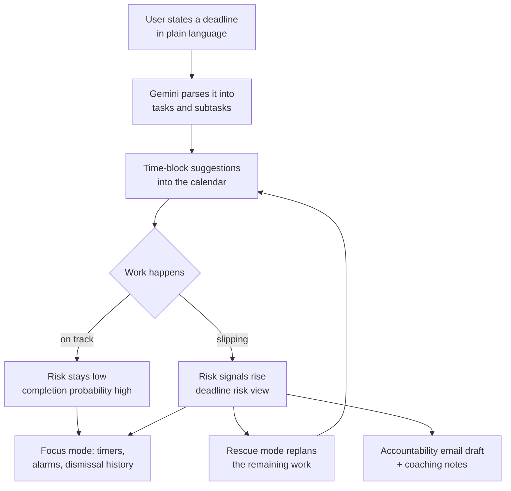

# Deadline Guardian

An AI-assisted planning and focus app that turns a natural-language deadline into tasks, schedules, risk signals, and recovery plans. The project is designed to help users notice when a plan is slipping and reorganize the remaining work.

## Core features

- Natural-language task parsing with Gemini
- AI-generated subtasks and time-block suggestions
- Deadline-risk and completion-probability views
- Focus mode, timers, alarms, and dismissal history
- Rescue-mode replanning when work falls behind
- Preparation-material and coaching-note generation
- Smart accountability-email drafting
- Firebase-backed authentication and application data
- Optional Google service integrations

## Architecture

~~~mermaid
flowchart TD
  A[React client] --> B[Express API]
  B --> C[Gemini services]
  A --> D[Firebase]
  B --> E[Optional Google APIs]
~~~

## Tech stack

- React 19 and TypeScript
- Vite 6 and Tailwind CSS 4
- Node.js and Express
- Google Gen AI SDK
- Firebase
- Google APIs
- Motion, Recharts, D3, and jsPDF

## Run locally

Requirements: Node.js 20 or newer and a Gemini API key.

~~~bash
git clone https://github.com/saishivasanjeethpaikarao-jpg/DEADLINE-GUARDIAN.git
cd DEADLINE-GUARDIAN
npm install
cp .env.example .env
npm run dev
~~~

Add `GEMINI_API_KEY` to `.env`, then open `http://localhost:3000`.

## Build and start

~~~bash
npm run build
npm start
~~~

## API overview

The Express server provides endpoints for task parsing, schedule generation, coaching notes, preparation material, deadline insights, email drafts, subtask breakdowns, and the in-app assistant. See `server.ts` and `server/gemini.ts` for the current request and response shapes.

## Security and privacy

- Keep API keys and Google credentials in local environment variables or the deployment secret manager.
- Do not commit `.env` files.
- Use least-privilege Firebase rules and test them before storing real user data.
- Require explicit user confirmation before sending email or changing external calendars.

## Status

Working prototype under active development. Gemini features require a configured provider key. Firebase, email, and Google integrations require separate projects, credentials, redirect URLs, and production security review. Risk scores are planning aids, not guarantees.

## How a deadline flows through the app

